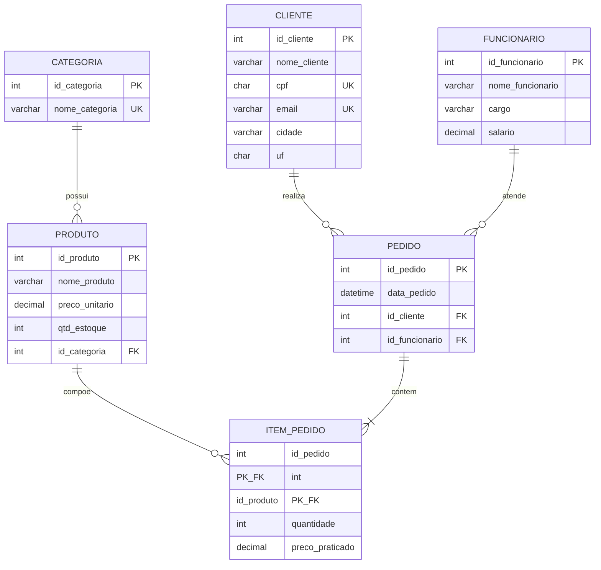

# TechShop Eletrônicos — Banco de Dados Relacional

**Integrantes:** Felipe Siqueira, Lucas Hu, Luiggi e Giuseppe  
**Instituição:** Universidade Presbiteriana Mackenzie  
**Curso:** Engenharia da Computação  
**Disciplina:** Banco de Dados Relacional  
**SGBD:** MySQL 8.0+ (Engine InnoDB)

---

## 1. Visão Geral

Projeto prático de modelagem e implementação de banco de dados relacional para a **TechShop Eletrônicos**, cobrindo o fluxo de vendas, gestão de estoque e comissão de vendedores.

O projeto foi modelado e implementado atendendo aos critérios da disciplina:
- 6 tabelas relacionais em Terceira Forma Normal (3FN)
- Chaves primárias e estrangeiras com integridade referencial via InnoDB
- Mais de 100 registros coerentes populando o banco
- 10 consultas SQL com junções, agregações, subconsultas e rankings
- 2 índices B-Tree justificados com análise de execução `EXPLAIN`
- 1 operação transacional ACID com controle de concorrência e baixa de estoque

---

## 2. Diagrama Entidade-Relacionamento



---

## 3. Estrutura do Repositório

```
Banco-de-dados/
├── PROJETO_BANCO_DE_DADOS_MACKENZIE.md   # Relatório completo do projeto
├── README.md                             # Documentação geral
├── diagrams/
│   └── modelo_er.mmd                     # Diagrama Mermaid
└── sql/
    ├── 01_schema.sql                     # Criação da base e tabelas (DDL)
    ├── 02_seed.sql                       # Carga com dados coerentes
    ├── 03_indexes.sql                    # Índices B-Tree e EXPLAIN
    ├── 04_queries.sql                    # As 10 consultas SQL
    └── 05_transactions.sql               # Operação com transação ACID
```

---

## 4. Instruções de Execução no MySQL

Abra o terminal MySQL, MySQL Workbench ou phpMyAdmin e execute os arquivos na ordem:

```sql
source sql/01_schema.sql;
source sql/02_seed.sql;
source sql/03_indexes.sql;
source sql/04_queries.sql;
source sql/05_transactions.sql;
```

---

## 5. Licença

Projeto desenvolvido para fins acadêmicos na Universidade Presbiteriana Mackenzie.
Distribuído sob a licença MIT.
