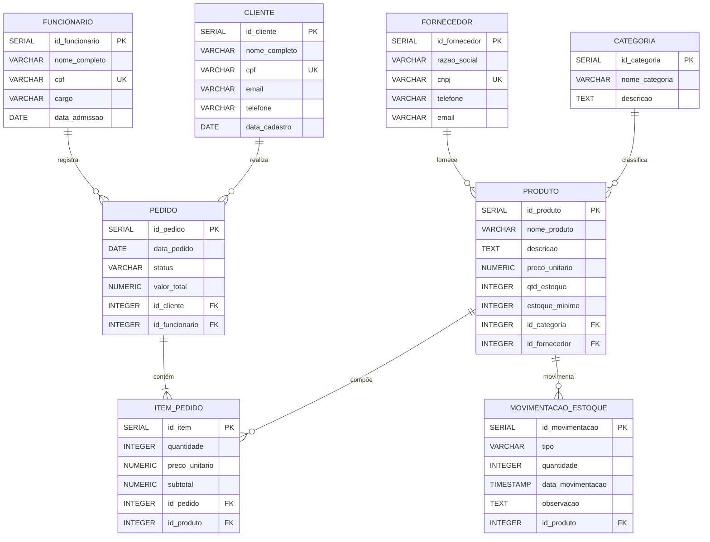

# TechShop Eletrônicos — Modelagem de Dados

## Modelo Entidade-Relacionamento (ER)

---

## 1. Introdução

A modelagem de dados é a etapa fundamental no projeto de um banco de dados relacional. Ela consiste na representação abstrata das entidades do domínio de negócio, seus atributos e os relacionamentos entre elas, servindo como ponte entre os requisitos levantados e a implementação física no SGBD.

Neste projeto, adotamos a **abordagem relacional** proposta por Edgar F. Codd (1970), na qual os dados são organizados em **tabelas** (relações) compostas por **linhas** (tuplas) e **colunas** (atributos). Cada tabela possui uma **chave primária** (PK) que identifica univocamente cada registro, e os relacionamentos entre tabelas são estabelecidos por **chaves estrangeiras** (FK).

A modelagem foi realizada em duas etapas complementares:

1. **Modelo Conceitual**: representação de alto nível das entidades e relacionamentos por meio do Diagrama Entidade-Relacionamento (ER), independente de tecnologia;
2. **Modelo Lógico**: refinamento do modelo conceitual com tipos de dados, constraints e regras de integridade específicas do PostgreSQL.

O diagrama ER a seguir utiliza a notação Mermaid e representa a estrutura completa do banco de dados da TechShop Eletrônicos, com todas as 8 entidades, seus atributos e os relacionamentos com cardinalidade.

---

## 2. Diagrama Entidade-Relacionamento

---

## 3. Descrição das Entidades

### 3.1 CATEGORIA

A entidade **CATEGORIA** representa as classificações sob as quais os produtos da TechShop são organizados. Cada categoria agrupa produtos de natureza semelhante (por exemplo: "Smartphones", "Notebooks", "Periféricos"), facilitando a navegação no catálogo e a geração de relatórios por segmento.

- **Chave Primária**: `id_categoria` — identificador sequencial gerado automaticamente (SERIAL).
- **Atributos**: `nome_categoria` (nome da categoria, obrigatório), `descricao` (texto livre descritivo, opcional).
- **Volume estimado**: 5 a 20 categorias distintas.

### 3.2 FORNECEDOR

A entidade **FORNECEDOR** armazena os dados das empresas que abastecem a TechShop com mercadorias. Cada fornecedor é identificado por seu CNPJ, garantindo unicidade cadastral. As informações de contato (telefone e e-mail) são essenciais para o processo de reposição de estoque.

- **Chave Primária**: `id_fornecedor` — identificador sequencial gerado automaticamente.
- **Constraint UNIQUE**: `cnpj` — impede o cadastro duplicado de fornecedores.
- **Atributos**: `razao_social`, `cnpj`, `telefone`, `email`.
- **Volume estimado**: 5 a 30 fornecedores.

### 3.3 PRODUTO

A entidade **PRODUTO** é central no modelo e representa cada item comercializado pela TechShop. Contém informações comerciais (nome, descrição, preço), logísticas (quantidade em estoque, estoque mínimo) e classificatórias (categoria, fornecedor).

- **Chave Primária**: `id_produto` — identificador sequencial gerado automaticamente.
- **Chaves Estrangeiras**: `id_categoria` → CATEGORIA, `id_fornecedor` → FORNECEDOR.
- **Constraints CHECK**: `preco_unitario > 0` (preço deve ser positivo), `qtd_estoque >= 0` (estoque não pode ser negativo), `estoque_minimo >= 0`.
- **Volume estimado**: 50 a 500 produtos.

### 3.4 CLIENTE

A entidade **CLIENTE** registra as pessoas físicas que realizam compras na TechShop. O CPF é utilizado como identificador natural único, enquanto o `id_cliente` serve como chave primária surrogate para otimização de joins.

- **Chave Primária**: `id_cliente` — identificador sequencial gerado automaticamente.
- **Constraint UNIQUE**: `cpf` — impede duplicidade de cadastro.
- **Atributos**: `nome_completo`, `cpf`, `email`, `telefone`, `data_cadastro`.
- **Volume estimado**: 100 a 5.000 clientes.

### 3.5 FUNCIONARIO

A entidade **FUNCIONARIO** armazena os dados dos colaboradores da TechShop que operam o sistema. O campo `cargo` é restrito a valores predefinidos por meio de uma constraint CHECK, garantindo padronização.

- **Chave Primária**: `id_funcionario` — identificador sequencial gerado automaticamente.
- **Constraint UNIQUE**: `cpf` — impede duplicidade de cadastro.
- **Constraint CHECK**: `cargo IN ('Vendedor', 'Gerente', 'Estoquista')` — restringe a valores válidos.
- **Atributos**: `nome_completo`, `cpf`, `cargo`, `data_admissao`.
- **Volume estimado**: 5 a 50 funcionários.

### 3.6 PEDIDO

A entidade **PEDIDO** registra cada transação de venda realizada na loja. Cada pedido está vinculado a um cliente (quem comprou) e a um funcionário (quem efetuou a venda), estabelecendo rastreabilidade completa.

- **Chave Primária**: `id_pedido` — identificador sequencial gerado automaticamente.
- **Chaves Estrangeiras**: `id_cliente` → CLIENTE, `id_funcionario` → FUNCIONARIO.
- **Constraint CHECK**: `status IN ('Pendente', 'Confirmado', 'Cancelado')` — controla o ciclo de vida do pedido.
- **Atributos**: `data_pedido`, `status`, `valor_total`, `id_cliente`, `id_funcionario`.
- **Volume estimado**: 500 a 50.000 pedidos.

### 3.7 ITEM_PEDIDO

A entidade **ITEM_PEDIDO** representa a tabela associativa que detalha quais produtos e em quais quantidades compõem cada pedido. É o nível mais granular da transação de venda e contém o preço praticado no momento da venda (que pode diferir do preço atual do produto).

- **Chave Primária**: `id_item` — identificador sequencial gerado automaticamente.
- **Chaves Estrangeiras**: `id_pedido` → PEDIDO, `id_produto` → PRODUTO.
- **Constraints CHECK**: `quantidade > 0` (quantidade deve ser positiva), `preco_unitario > 0`.
- **Atributo calculado**: `subtotal` = `quantidade * preco_unitario`.
- **Volume estimado**: 1.000 a 200.000 itens.

### 3.8 MOVIMENTACAO_ESTOQUE

A entidade **MOVIMENTACAO_ESTOQUE** registra o histórico completo de todas as movimentações de estoque de cada produto. Cada registro captura o tipo de movimentação, a quantidade afetada, o momento exato e uma observação contextual.

- **Chave Primária**: `id_movimentacao` — identificador sequencial gerado automaticamente.
- **Chave Estrangeira**: `id_produto` → PRODUTO.
- **Constraint CHECK**: `tipo IN ('entrada', 'saida', 'ajuste', 'devolucao')` — restringe a tipos válidos.
- **Constraint CHECK**: `quantidade > 0` — quantidade movimentada deve ser positiva.
- **Atributos**: `tipo`, `quantidade`, `data_movimentacao`, `observacao`, `id_produto`.
- **Volume estimado**: 2.000 a 500.000 movimentações.

---

## 4. Descrição dos Relacionamentos

### 4.1 CATEGORIA → PRODUTO (classifica)

| Propriedade | Valor |
|---|---|
| **Cardinalidade** | 1:N (um-para-muitos) |
| **Leitura** | Uma CATEGORIA classifica zero ou mais PRODUTOS. Um PRODUTO pertence a exatamente uma CATEGORIA. |
| **Chave Estrangeira** | `PRODUTO.id_categoria` → `CATEGORIA.id_categoria` |
| **Obrigatoriedade** | Obrigatória no lado PRODUTO (todo produto deve ter uma categoria) |
| **Regra de exclusão** | `ON DELETE RESTRICT` — não é possível excluir uma categoria que possua produtos vinculados |
| **Exemplo** | A categoria "Smartphones" classifica os produtos "iPhone 15 Pro", "Galaxy S24", "Pixel 8". |

### 4.2 FORNECEDOR → PRODUTO (fornece)

| Propriedade | Valor |
|---|---|
| **Cardinalidade** | 1:N (um-para-muitos) |
| **Leitura** | Um FORNECEDOR fornece zero ou mais PRODUTOS. Um PRODUTO é fornecido por exatamente um FORNECEDOR. |
| **Chave Estrangeira** | `PRODUTO.id_fornecedor` → `FORNECEDOR.id_fornecedor` |
| **Obrigatoriedade** | Obrigatória no lado PRODUTO (todo produto deve ter um fornecedor) |
| **Regra de exclusão** | `ON DELETE RESTRICT` — não é possível excluir um fornecedor que possua produtos vinculados |
| **Exemplo** | O fornecedor "Samsung Brasil Ltda." fornece "Galaxy S24", "Galaxy Tab S9", "Monitor Odyssey". |

### 4.3 CLIENTE → PEDIDO (realiza)

| Propriedade | Valor |
|---|---|
| **Cardinalidade** | 1:N (um-para-muitos) |
| **Leitura** | Um CLIENTE realiza zero ou mais PEDIDOS. Um PEDIDO é realizado por exatamente um CLIENTE. |
| **Chave Estrangeira** | `PEDIDO.id_cliente` → `CLIENTE.id_cliente` |
| **Obrigatoriedade** | Obrigatória no lado PEDIDO (todo pedido deve estar vinculado a um cliente) |
| **Regra de exclusão** | `ON DELETE RESTRICT` — não é possível excluir um cliente que possua pedidos registrados |
| **Exemplo** | O cliente "Ana Silva" realizou 3 pedidos nos últimos 6 meses. O cliente "Carlos Souza" é cadastrado mas ainda não realizou nenhum pedido (cliente inativo). |

### 4.4 FUNCIONARIO → PEDIDO (registra)

| Propriedade | Valor |
|---|---|
| **Cardinalidade** | 1:N (um-para-muitos) |
| **Leitura** | Um FUNCIONARIO registra zero ou mais PEDIDOS. Um PEDIDO é registrado por exatamente um FUNCIONARIO. |
| **Chave Estrangeira** | `PEDIDO.id_funcionario` → `FUNCIONARIO.id_funcionario` |
| **Obrigatoriedade** | Obrigatória no lado PEDIDO (todo pedido deve ter um funcionário responsável) |
| **Regra de exclusão** | `ON DELETE RESTRICT` — não é possível excluir um funcionário que possua pedidos registrados |
| **Exemplo** | O vendedor "João Santos" registrou 15 pedidos no mês atual. |

### 4.5 PEDIDO → ITEM_PEDIDO (contém)

| Propriedade | Valor |
|---|---|
| **Cardinalidade** | 1:N (um-para-muitos, com mínimo 1) |
| **Leitura** | Um PEDIDO contém um ou mais ITENS_PEDIDO. Um ITEM_PEDIDO pertence a exatamente um PEDIDO. |
| **Chave Estrangeira** | `ITEM_PEDIDO.id_pedido` → `PEDIDO.id_pedido` |
| **Obrigatoriedade** | Obrigatória em ambos os lados (todo pedido deve ter pelo menos um item; todo item deve pertencer a um pedido) |
| **Regra de exclusão** | `ON DELETE RESTRICT` — não é possível excluir um pedido que possua itens vinculados |
| **Observação** | A cardinalidade mínima de 1 no lado ITEM_PEDIDO é uma regra de negócio (não é possível confirmar um pedido vazio), mas não é aplicável apenas por constraints — requer validação na aplicação ou trigger. |

### 4.6 PRODUTO → ITEM_PEDIDO (compõe)

| Propriedade | Valor |
|---|---|
| **Cardinalidade** | 1:N (um-para-muitos) |
| **Leitura** | Um PRODUTO compõe zero ou mais ITENS_PEDIDO. Um ITEM_PEDIDO refere-se a exatamente um PRODUTO. |
| **Chave Estrangeira** | `ITEM_PEDIDO.id_produto` → `PRODUTO.id_produto` |
| **Obrigatoriedade** | Obrigatória no lado ITEM_PEDIDO (todo item deve referenciar um produto existente) |
| **Regra de exclusão** | `ON DELETE RESTRICT` — não é possível excluir um produto que já tenha sido vendido (presente em itens de pedido) |

### 4.7 PRODUTO → MOVIMENTACAO_ESTOQUE (movimenta)

| Propriedade | Valor |
|---|---|
| **Cardinalidade** | 1:N (um-para-muitos) |
| **Leitura** | Um PRODUTO possui zero ou mais MOVIMENTACOES_ESTOQUE. Uma MOVIMENTACAO_ESTOQUE refere-se a exatamente um PRODUTO. |
| **Chave Estrangeira** | `MOVIMENTACAO_ESTOQUE.id_produto` → `PRODUTO.id_produto` |
| **Obrigatoriedade** | Obrigatória no lado MOVIMENTACAO_ESTOQUE (toda movimentação deve referenciar um produto) |
| **Regra de exclusão** | `ON DELETE RESTRICT` — não é possível excluir um produto que possua histórico de movimentações |

---

## 5. Regras de Negócio Aplicadas pelo Modelo

O modelo de dados implementa as seguintes regras de negócio diretamente no nível do esquema, sem depender da aplicação cliente:

| # | Regra de Negócio | Mecanismo de Implementação |
|---|---|---|
| RN01 | Cada cliente é identificado univocamente por seu CPF | `UNIQUE(cpf)` na tabela CLIENTE |
| RN02 | Cada fornecedor é identificado univocamente por seu CNPJ | `UNIQUE(cnpj)` na tabela FORNECEDOR |
| RN03 | Cada funcionário é identificado univocamente por seu CPF | `UNIQUE(cpf)` na tabela FUNCIONARIO |
| RN04 | O preço de um produto deve ser positivo | `CHECK(preco_unitario > 0)` na tabela PRODUTO |
| RN05 | A quantidade em estoque não pode ser negativa | `CHECK(qtd_estoque >= 0)` na tabela PRODUTO |
| RN06 | O estoque mínimo não pode ser negativo | `CHECK(estoque_minimo >= 0)` na tabela PRODUTO |
| RN07 | Todo produto deve pertencer a uma categoria existente | `FOREIGN KEY(id_categoria) REFERENCES CATEGORIA` |
| RN08 | Todo produto deve ter um fornecedor existente | `FOREIGN KEY(id_fornecedor) REFERENCES FORNECEDOR` |
| RN09 | O cargo do funcionário deve ser Vendedor, Gerente ou Estoquista | `CHECK(cargo IN ('Vendedor','Gerente','Estoquista'))` |
| RN10 | O status do pedido deve ser Pendente, Confirmado ou Cancelado | `CHECK(status IN ('Pendente','Confirmado','Cancelado'))` |
| RN11 | Todo pedido deve estar vinculado a um cliente e a um funcionário | `NOT NULL` + FK em `id_cliente` e `id_funcionario` |
| RN12 | A quantidade de cada item deve ser positiva | `CHECK(quantidade > 0)` na tabela ITEM_PEDIDO |
| RN13 | O tipo de movimentação deve ser entrada, saída, ajuste ou devolução | `CHECK(tipo IN ('entrada','saida','ajuste','devolucao'))` |
| RN14 | Registros pai não podem ser excluídos se possuírem dependências | `ON DELETE RESTRICT` em todas as FKs |
| RN15 | Cada produto possui um limiar mínimo de estoque para alerta de reposição | Campo `estoque_minimo` comparado com `qtd_estoque` em consulta |

---

## 6. Decisões de Modelagem

### 6.1 Chaves Primárias Surrogates

Optou-se por utilizar chaves primárias do tipo **SERIAL** (auto-incremento) em todas as tabelas, em vez de chaves naturais (CPF, CNPJ). As razões para essa decisão são:

- **Desempenho**: inteiros ocupam menos espaço e são mais eficientes em operações de JOIN;
- **Estabilidade**: CPFs e CNPJs podem conter erros de digitação que exigiriam atualização em cascata;
- **Uniformidade**: todas as tabelas seguem o mesmo padrão de nomenclatura (`id_<entidade>`).

As chaves naturais (CPF, CNPJ) são mantidas como constraints `UNIQUE` para garantir unicidade de negócio.

### 6.2 Preço no ITEM_PEDIDO

O preço unitário é armazenado tanto na tabela PRODUTO (preço atual) quanto na tabela ITEM_PEDIDO (preço praticado na venda). Essa redundância controlada é intencional:

- O preço de um produto pode ser alterado após uma venda (promoções, reajustes);
- O registro do preço praticado no momento da venda preserva a integridade histórica do faturamento;
- Sem essa duplicação, a alteração do preço do produto afetaria retroativamente todos os pedidos anteriores.

### 6.3 Subtotal Armazenado

O campo `subtotal` em ITEM_PEDIDO armazena o resultado de `quantidade * preco_unitario`. Embora seja um campo derivado (calculável), sua persistência foi escolhida para:

- Evitar recálculos frequentes em consultas de faturamento;
- Simplificar queries de relatório;
- Garantir consistência caso a lógica de cálculo evolua (ex.: inclusão de descontos por item).

---

> **Documento elaborado como parte do projeto acadêmico da disciplina de Banco de Dados — Engenharia da Computação — Universidade Presbiteriana Mackenzie.**
